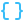
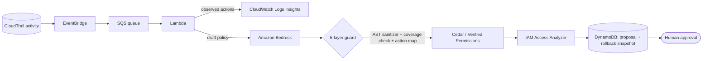
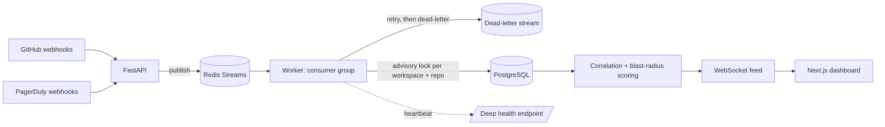
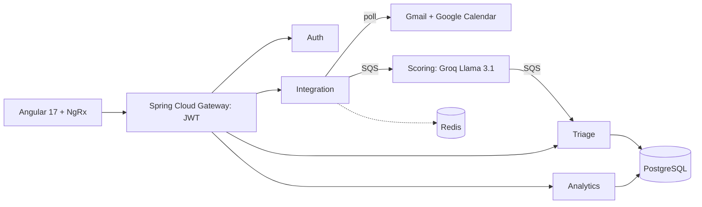

<!-- Profile repo: github.com/Akaash-S/Akaash-S (must be public).
     The banner, divider, footer and section icons are local SVG files in assets/ (commit that folder together with this README).
     To recolour the icons, change stroke="#38BDF8" inside assets/icons/*.svg. -->

<!-- ============================ BANNER ============================ -->

 

  

<!-- ============================ ABOUT ============================ -->

<h2>&nbsp; About</h2>

I build **backend systems that handle failure well**: event-driven pipelines, retries and dead-letter queues, race-condition-safe writes, and cloud tooling with security guardrails built in.

I'm a B.Tech Information Technology student (graduating 2027) and my primary language is **Java**, with most of my recent work in **Python** and **TypeScript**. I like projects where I own the full path from design to tests to deployment, and where I can explain every number I put on the page.

|  Education |  Core languages |  Problem solving |  Recognition |
|:---:|:---:|:---:|:---:|
| B.Tech IT, MSEC Class of 2027 | Java · Python SQL · TypeScript · Bash | 140+ LeetCode problems (Java, SQL) | Winner, Hackintym'25 (college level) |

<!-- ============================ PROJECTS ============================ -->

<h2>&nbsp; Featured Projects</h2>

<h3>&nbsp; Cedar-Sentinel: IAM Least-Privilege Policy Tightener</h3>

*Solo project · Sep 2026 · AWS, Python, Terraform*

An event-driven AWS pipeline that reads what a role actually did in CloudTrail and proposes a tighter IAM policy. An LLM drafts the policy, and **five independent guard layers** check it before a human approves anything. The Lambda role itself has **zero IAM write permissions**.

| Result | Detail |
|---|---|
|  **4 → 1** statements | A test role with service-wide wildcards (`s3:*`, `dynamodb:*`, `ec2:*`, `logs:*`) became 1 statement of 6 observed S3 actions |
|  **No new access** | Confirmed with IAM Access Analyzer `CheckNoNewAccess` |
|  **5-layer guard** | AST sanitizer, coverage/lockout check, CloudTrail-to-IAM action map, Cedar (Verified Permissions) validation, Access Analyzer |
|  **38 tests** | Unit and integration, including live Access Analyzer checks |
|  **~$0.0001** | Approximate Bedrock cost per analysis |

 <b>Architecture</b>

 <b>What I owned</b>

- Designed the whole pipeline and deployed it with **AWS SAM**.
- Designed the guard layers so a bad LLM draft can't lock a role out of what it actually uses.
- Wrote the tests, including live Access Analyzer checks.
- Kept the blast radius small: the Lambda role cannot write IAM, and applying a change needs a human `y/N`, with a DynamoDB rollback snapshot.

 **Next:** run it against a larger set of real CloudTrail history (tested on a dozen real events so far).

---

<h3>&nbsp; NexOps: Incident Intelligence Platform</h3>

*Solo project · Apr 2026 – present · Python, FastAPI, Redis Streams, PostgreSQL*

A distributed backend that ingests **GitHub and PagerDuty webhooks**, correlates related incidents, and scores the **blast radius** of a deployment across a dependency graph. It has a REST API, a WebSocket feed and a Next.js dashboard.

| Result | Detail |
|---|---|
|  **13 tables** | PostgreSQL schema managed with Alembic |
|  **Retries + dead-letter** | Redis Streams worker with consumer groups, retry counters and graceful shutdown |
|  **10 replays → 1 incident** | PostgreSQL advisory locks stop duplicate incidents under concurrent events |
|  **Deep health check** | Protected endpoint checks DB, Redis, worker heartbeat and external reachability, and returns HTTP 503 on failure |
|  **60+ pytest tests** | Race-condition, replay and scoring tests |

 <b>Architecture</b>

 <b>What I owned</b>

- Designed the service end to end: API, schema, worker, scoring and dashboard.
- Solved the duplicate-incident race with advisory locks, and proved it with concurrent replay tests.
- Added bounded, feedback-driven recalibration of the scoring weights.
- Added Sentry error tracking, a post-deploy smoke script and Docker/Render deployment configs.

 **Next:** load-test on production-like infrastructure (my load tests so far ran locally).

---

<h3>&nbsp; Signal: AI Communication Triage Platform</h3>

*Team project · Jul 2026 · Java 21, Spring Boot 3, AWS SQS, Angular*

A microservice platform that pulls in Gmail and Google Calendar, scores urgency with an LLM, and triages what needs attention first. I was the **primary contributor (81 of 87 commits)**.

| Result | Detail |
|---|---|
|  **Gateway + 5 services** | 7 Maven modules, 27 endpoints |
|  **8-container setup** | Docker Compose with AWS SQS (LocalStack), multi-schema PostgreSQL and Redis |
|  **Live ingestion** | Real Gmail and Google Calendar polling with OAuth2 refresh-token recovery |
|  **LLM migration** | Moved urgency scoring from OpenAI to Groq Llama 3.1 with strict JSON output |
|  **11 unit tests** | Scorer parsing and token refresh |

 <b>Architecture</b>

 <b>What I owned</b>

- Replaced mock data with live Gmail and Google Calendar ingestion.
- Handled OAuth2 refresh-token recovery: a revoked token marks the integration as expired instead of failing silently.
- Added an on-demand sync endpoint that runs the pollers in parallel.
- Migrated scoring to Groq, with explicit exceptions on API failure instead of silent fallbacks.
- Owned the Docker Compose orchestration and the Angular dashboard with Chart.js analytics.

 **Next:** encrypt stored OAuth refresh tokens at rest, and replace the Slack and Outlook stubs with real integrations.

---

<h3>&nbsp; SkillBridge: Career Learning Platform</h3>

*Solo project · 2025 – 2026 · React, TypeScript, Flask, Firestore, GCP*

A career-development platform that tracks skills, analyzes skill gaps against job roles, and generates personalized learning roadmaps with AI.

| Scope | Detail |
|---|---|
|  **133 endpoints** | 19 Flask blueprints and 21 backend services |
|  **28 Firestore collections** | Skills, roadmaps, progress, assessments and more |
|  **AI roadmaps** | Gemini and Groq with validation against a master skill catalog |
|  **Deployment** | Docker, Gunicorn and Nginx on a GCP VM, with scheduled Firestore backups |

 <b>What I owned</b>

- Designed the skill-gap and readiness-scoring logic and the roadmap generator.
- Moved authentication from localStorage tokens to httpOnly cookies.
- Wrote the VM setup and deployment scripts and the scheduled backup job.

 **Next:** split the 2 MB single JavaScript bundle with code-splitting (Lighthouse flagged it).

 <b>More projects</b>

 

-  **[AI Classroom Assistant](https://github.com/Akaash-S/classroomAssistant)** *(Individual)*: lecture audio to transcript, then Gemini summaries, exam notes and teacher-approved assignment tasks. Next.js and Flask with Firebase.
-  **Dynamic Meeting Assistant** *(Individual)*: speech processing, summaries and task extraction for meetings.
-  **MediMind AI** *(Contributed)*: AI-assisted healthcare-oriented platform.

<!-- ============================ STACK ============================ -->

<h2>&nbsp; Tech Stack</h2>

| | |
|:---|:---|
| **Languages** |  |
| **Backend** |  |
| **Data & messaging** |  |
| **Cloud & DevOps** |  |
| **Frontend** |  |
| **Tools** |  |

<!-- ============================ JOURNEY ============================ -->

<h2>&nbsp; Journey</h2>

| When | What |
|---|---|
| **Sep 2023** | Started B.Tech Information Technology at Meenakshi Sundararajan Engineering College |
| **2025** | Won **Hackintym'25** (college level) with an AI-assisted classroom assistant; started SkillBridge |
| **Apr 2026 – now** | Building and owning **NexOps** |
| **Jul 2026** | Led development of **Signal**, a Java 21 / Spring Boot microservice platform |
| **Sep 2026** | Designed and shipped **Cedar-Sentinel** on AWS |
| **Now** | Working through the **AWS Developer** learning path on Skill Builder, and practicing DSA |

<h3>&nbsp; Currently</h3>

 Deepening AWS &nbsp;·&nbsp;
 Making NexOps tests and CI more robust &nbsp;·&nbsp;
 Practicing data structures and algorithms

<!-- ============================ STATS ============================ -->

<h2>&nbsp; Stats</h2>

<picture>
  <source media="(prefers-color-scheme: dark)" srcset="https://github-readme-stats.vercel.app/api?username=Akaash-S&show_icons=true&theme=tokyonight&hide_border=true&include_all_commits=true&count_private=true&border_radius=12" />
  
</picture>
<picture>
  <source media="(prefers-color-scheme: dark)" srcset="https://github-readme-stats.vercel.app/api/top-langs/?username=Akaash-S&layout=compact&theme=tokyonight&hide_border=true&border_radius=12" />
  
</picture>

 

<picture>
  <source media="(prefers-color-scheme: dark)" srcset="https://streak-stats.demolab.com?user=Akaash-S&theme=tokyonight&hide_border=true&border_radius=12" />
  
</picture>

 

  

<!-- ============================ CONTACT ============================ -->

<h2>&nbsp; Let's connect</h2>

<!-- Add a resume badge here once the PDF has a public link:
 -->

 

*"Building scalable systems engineered for real-world impact."*

